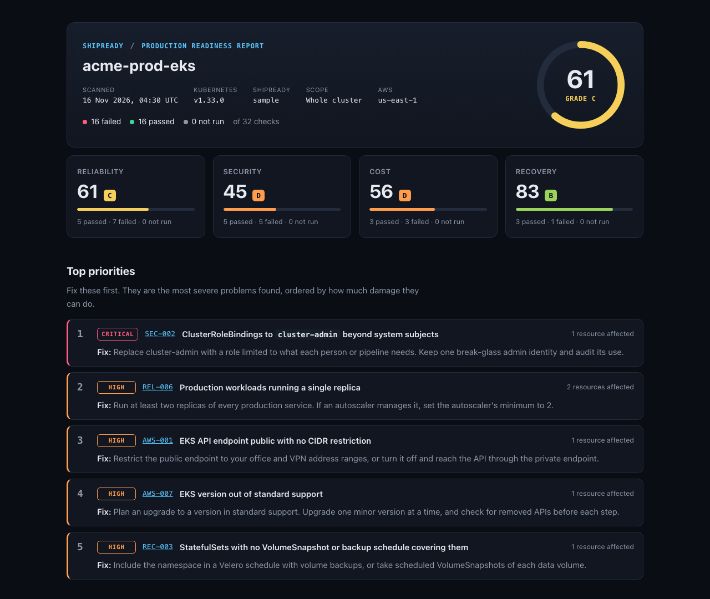

# ShipReady

Find out what is wrong with your Kubernetes cluster before it breaks.

ShipReady is a command-line scanner for teams that have outgrown their first cluster setup. You run it on your own machine with read-only access, and it writes one HTML report: a score, and a prioritized list of what to fix across reliability, security, cost and recovery.



See a full example: download [docs/sample-report.html](docs/sample-report.html) and open it in a browser.

## What it promises

- **Read-only.** It only lists resources. It never creates, changes or deletes anything, and never runs anything in your cluster.
- **Nothing leaves your machine.** No telemetry, no uploads, no account. It talks to your cluster and, if you ask, to your AWS account. Nothing else.
- **It never reads Secrets.** The scanner does not list Secrets at all, and the access role it asks for does not include them.
- **One binary, one file.** No dependencies to install. The report is a single HTML file that works offline.

These are enforced by tests in this repository, not just stated. The [access role](deploy/kubernetes/clusterrole.yaml) and the [IAM policy](deploy/aws/iam-policy.json) are checked against the calls the scanner actually makes.

## Install

Download the archive for your system from the [latest release](https://github.com/zarakM/shipready/releases/latest). On macOS or Linux:

```sh
# Pick one: darwin_arm64 (Apple silicon), darwin_amd64, linux_amd64, linux_arm64
PLATFORM=darwin_arm64

curl -fsSLO "https://github.com/zarakM/shipready/releases/latest/download/shipready_${PLATFORM}.tar.gz"
curl -fsSLO "https://github.com/zarakM/shipready/releases/latest/download/checksums.txt"
shasum -a 256 --check --ignore-missing checksums.txt

tar -xzf "shipready_${PLATFORM}.tar.gz"
./shipready version
```

On Windows, download `shipready_windows_amd64.zip` from the release page and unzip it.

With Go installed you can build it yourself instead:

```sh
go install github.com/zarakM/shipready/cmd/shipready@latest
```

**macOS note:** the binary is not signed by Apple. Downloading with `curl` as above works. If you download it with a browser, macOS will refuse to open it until you run `xattr -d com.apple.quarantine ./shipready`.

## Use

```sh
shipready scan
```

That scans the cluster your current kubeconfig context points at, prints a summary, and writes `shipready-report.html`:

```
ShipReady scan of acme-prod-eks (Kubernetes v1.33.0)

Overall score: 61/100 (grade C)

  Reliability  61 C  5 passed, 7 failed, 0 skipped
  Security     45 D  5 passed, 5 failed, 0 skipped
  Cost         56 D  3 passed, 3 failed, 0 skipped
  Recovery     83 B  3 passed, 1 failed, 0 skipped

Top priorities
  1. [CRITICAL] SEC-002 ClusterRoleBindings to `cluster-admin` beyond system subjects (1 resource affected)
     Fix: Replace cluster-admin with a role limited to what each person or pipeline needs. ...
```

### Options

| Flag | What it does |
| --- | --- |
| `--context <name>` | Scan a different kubeconfig context. |
| `--namespace <a,b>` | Limit the scan to some namespaces. Checks that need the whole cluster are skipped and say so. |
| `--aws` | Also check the AWS side: the EKS control plane, node groups, load balancers, databases and unattached disks. |
| `--aws-region`, `--eks-cluster` | Tell `--aws` which cluster to look at, if it cannot work it out from your kubeconfig. |
| `--format html,json` | Choose the report format. JSON has the same data in a stable schema. |
| `--output <path>` | Where to write the report. |
| `--skip <ids>` | Skip checks by ID (`REL-007`) or by category (`cost`). |
| `--fail-on critical\|high` | Exit with code 2 when a check of that severity fails. For CI. |

`shipready checks` lists every check with its ID, category and severity.

### What it checks

| Category | The question | Examples |
| --- | --- | --- |
| Reliability | Will it stay up? | Missing requests, limits and probes; single replicas; one availability zone; expiring certificates; unsupported EKS version |
| Security | Who can get in, and how far? | Root and privileged containers; cluster-admin grants; secrets in plain environment variables; no network policies; public API endpoint |
| Cost | Are you paying for capacity nobody uses? | Requests far above usage; mostly empty nodes; unattached disks; idle load balancers |
| Recovery | Can you get your data back? | No backup tool; backups that stopped succeeding; databases and volumes with no backup |

There are 32 checks: 25 for Kubernetes and 7 for AWS. A check that cannot run, because of a missing permission or an add-on that is not installed, is listed as skipped with the reason. It never stops the scan, and it is left out of the score.

### Scoring

Each check passes or fails once, however many resources it affects. Checks are weighted by severity (critical 10, high 5, medium 2, low 1), each category gets a score out of 100, and the overall score is the average of the four. Grades: 90 and up is A, 75 is B, 60 is C, 40 is D, below that F.

### In CI

```sh
shipready scan --format json --output report.json --fail-on critical
```

| Exit code | Meaning |
| --- | --- |
| 0 | The scan completed. |
| 1 | The scan could not run, for example because the cluster was unreachable. |
| 2 | The scan completed and `--fail-on` was tripped. The report is still written in full. |

## Permissions

If you are a cluster admin, `shipready scan` just works. To scan with the least access possible, or to let someone else scan your cluster, use the two files in [`deploy/`](deploy/).

### Kubernetes

[`deploy/kubernetes/clusterrole.yaml`](deploy/kubernetes/clusterrole.yaml) grants `list` on the resource types the scanner reads, and nothing else. It is bound to a group named `shipready-readonly`.

```sh
kubectl apply -f deploy/kubernetes/clusterrole.yaml

# On EKS, give an IAM role or user that group:
aws eks create-access-entry --cluster-name <cluster> \
  --principal-arn <iam-role-or-user-arn> \
  --kubernetes-groups shipready-readonly
```

Access entries need the cluster's authentication mode to be `API` or `API_AND_CONFIG_MAP`.

### AWS (only for `--aws`)

[`deploy/aws/iam-policy.json`](deploy/aws/iam-policy.json) allows eleven `Describe` and `List` actions on EKS, EC2, load balancing and RDS.

```sh
aws iam create-policy --policy-name shipready-readonly \
  --policy-document file://deploy/aws/iam-policy.json
```

Attach it to the role or user that runs the scan. `--aws` uses your normal AWS credentials: environment variables, `AWS_PROFILE`, SSO or an instance role.

If AWS cannot be reached, the scan still completes. The AWS checks are listed as skipped with the reason, and the Kubernetes results are reported in full.

## What it does not do

- Fix anything. ShipReady only reads.
- Scan container images for vulnerabilities. Use [Trivy](https://trivy.dev) for that.
- Check Azure or Google Cloud resources. The Kubernetes checks work on any cluster; the cloud checks are AWS only.
- See backups taken outside the cluster, such as AWS Backup. The backup checks may flag a cluster that is in fact covered that way.

## Development

```sh
go build ./cmd/shipready
go test ./...
go vet ./...
golangci-lint run
```

No test needs a cluster or an AWS account; everything runs against fixtures in `testdata/` and in-memory fakes. The product spec, including the exact rule behind every check, is in [docs/SPEC.md](docs/SPEC.md).

Releases are built with [GoReleaser](https://goreleaser.com). Pushing a tag such as `v0.1.0` builds all platforms and creates a draft release.

## License

[Apache License 2.0](LICENSE).
